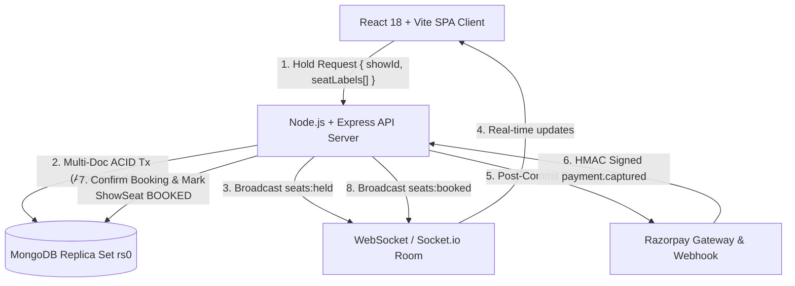

# IMovies — "Movie ticket booking made simple."

> A complete, enterprise-grade MERN-stack movie ticket and seat booking platform built with React 18, Vite, Node.js (v20 LTS), Express, MongoDB Replica Set (ACID transactions), Socket.io, and Razorpay test-mode integration.

---

## 1. System Overview & Architectural Invariants

IMovies delivers a seamless, modern cinema experience for moviegoers and a real-time operational back-office for theatre administrators. The system is engineered around non-negotiable architectural principles:



### Non-Negotiable Hard Rules
1. **Roles & RBAC**: Exactly two roles — `USER` and `ADMIN`. Counter tasks (verification, refunds, manual adjustments) are handled exclusively under `ADMIN`.
2. **Zero Client Trust for Money**: Booking requests only accept `{ showId, seatLabels[], couponCode? }`. Subtotal, convenience fees, discounts, and totals are computed strictly **server-side** from database documents. Client-supplied amounts are strictly forbidden.
3. **Integer Paise Standard**: All monetary calculations and database fields store values in integer paise (1 INR = 100 paise) to eliminate floating-point inaccuracies.
4. **Seat Concurrency & Hold Engine**:
   - Conditional atomic update inside multi-document ACID transactions ensures that under high concurrent load, exactly 1 request acquires the hold and all competing requests receive `409 Conflict` (`SEAT_UNAVAILABLE`).
   - Single source of truth: `seatAvailability.service.js` determines availability across seat maps, holds, payments, and admin views.
   - Holds expire automatically after 7 minutes (node-cron clean-up and query-time expiration).
   - Single live hold per user per show (`409 UNPAID_HOLD`).
5. **Time & Dates in IST (`Asia/Kolkata`)**: Server runs in UTC and true ISO instants are stored in MongoDB. All business rules, show scheduling, calendar days, cutoff hours, and customer displays use Indian Standard Time via `utils/ist-date.js`.
6. **Destructive UI Safeguards**: All destructive actions (screen deletion, show cancellation, seat release) use a shared `ConfirmDialog` component — native `window.confirm()` is forbidden.

---

## 2. Technology Stack

| Layer | Technologies |
| :--- | :--- |
| **Frontend** | React 18, Vite 5, Bootstrap 5 (Dark Theme), CSS Design Tokens, React Router DOM v6, Lucide React, Recharts, React Hot Toast, React QR Code, HTML2Canvas |
| **Backend** | Node.js (v20 LTS), Express 4, Mongoose 8, Zod Validation, Nanoid, Helmet, Morgan, Cookie-Parser, CORS, Express-Rate-Limit, Node-Cron |
| **Database** | MongoDB 7+ running as local replica set (`rs0`) for multi-document ACID transactions |
| **Real-Time** | Socket.io 4 (room-based screening updates: `seats:held`, `seats:released`, `seats:booked`) with 10s poll fallback |
| **Payments** | Razorpay Node SDK, HMAC-SHA256 raw webhook signature verification, test mode simulation |
| **Testing** | Jest 29, Supertest 7 (13 backend unit/integration tests) + standalone automated E2E script |

---

## 3. Getting Started & Local Setup

### Prerequisites
- **Node.js**: v20 LTS or higher (`node -v`)
- **MongoDB**: v7+ configured with replica set `rs0` enabled (required for multi-document transactions).
  - To enable replica set on macOS Homebrew:
    ```bash
    # Edit /opt/homebrew/etc/mongod.conf and add:
    # replication:
    #   replSetName: rs0
    brew services restart mongodb-community
    mongosh --eval "rs.initiate()"
    ```

### Installation

```bash
# Clone the repository and install all dependencies (root, server, and client)
git clone <repo-url>
cd "movies seat booking "

# Install dependencies
npm install
npm --prefix server install
npm --prefix client install
```

### Environment Configuration

The repository includes pre-configured development environment files:
- **Server**: `server/.env.development`
- **Client**: `client/.env.development`

```env
# Server (.env.development)
PORT=5001
NODE_ENV=development
MONGODB_URI=mongodb://127.0.0.1:27017/imovies_dev?replicaSet=rs0
JWT_SECRET=imovies_dev_jwt_secret_super_secure_key_987654321
JWT_EXPIRES_IN=7d
CLIENT_URL=http://localhost:5173
RAZORPAY_KEY_ID=rzp_test_imovies_dummy_key_id
RAZORPAY_KEY_SECRET=rzp_test_imovies_dummy_secret
RAZORPAY_WEBHOOK_SECRET=rzp_test_imovies_webhook_secret_123
HOLD_MINUTES=7
CONVENIENCE_FEE_PERCENT=5
MAX_SEATS_PER_BOOKING=8
```

### Database Seeding

Populate the database with demo movies, theatres, screens, shows across the next 7 days in IST, seat layouts, and promotional coupons:

```bash
npm run seed
```

**Seed Summary**:
- **Admin**: `admin@imovies.com` / `Admin@123`
- **Demo Users**:
  - `rahul@example.com` / `User@123`
  - `priya@example.com` / `User@123`
  - `amit@example.com` / `User@123`
- **2 Multiplexes**: *IMovies PVR Icon* (Mumbai) & *IMovies INOX Forum* (Bengaluru)
- **3 Screens**: Audi 1 (Dolby Atmos), IMAX Laser, Audi 2 (4DX)
- **8 Movies**: Now Showing & Upcoming titles with banners, trailers, and cast credits
- **42 Shows**: Scheduled across the next 7 days in IST
- **2,520 Seats**: Pre-allocated inventory records with compound unique index `{ showId: 1, seatLabel: 1 }`
- **Coupons**: `FLAT100` (₹100 flat off), `WELCOME50` (50% off), `IMOVIES20` (20% off)

---

## 4. Running the Application

You can launch both server and client concurrently using a single command:

```bash
# Starts Express server on http://localhost:5001 and Vite client on http://localhost:5173
npm run dev
```

Alternatively, run them in separate terminal sessions:
```bash
# Terminal 1: Backend API
npm run dev:server

# Terminal 2: Frontend Client
npm run dev:client
```

---

## 5. Verification & Testing

### A. Run All Automated Test Suites
```bash
# Run unit & integration test suites (13/13 passing)
npm test

# Run the comprehensive 13-step End-to-End lifecycle test script
npm run test:e2e
```

### B. Lint & Production Bundle Build
```bash
# Lint backend and frontend code (0 errors)
npm run lint

# Compile production client build
npm run build
```

---

## 6. End-to-End Walkthrough Guide

1. **Browse Movies**: Navigate to `http://localhost:5173`. Browse movies by city (Mumbai or Bengaluru) and genres.
2. **Select Showtime**: Click any movie card, watch the trailer, and pick an upcoming showtime chip.
3. **Interactive Seat Map**: Pick seats from the curved auditorium layout. Notice category badges (`VIP`, `PREMIUM`, `REGULAR`) and pricing.
4. **Fast Demo Login**: On the login page, click the **"User Demo"** button to instantly populate `rahul@example.com` / `User@123` and sign in.
5. **Checkout & Hold Timer**:
   - The 7-minute seat hold timer starts running.
   - Enter coupon code `FLAT100` and click **Apply** to receive ₹100 discount.
   - Click **"Simulate Instant Payment (Test Mode)"** (or use the Razorpay modal) to confirm the booking atomically.
6. **Printable E-Ticket**: View the confirmed ticket with its QR code. Click **"Print / Save PDF"** to preview the print layout.
7. **Admin Portal**:
   - Sign in as Admin (`admin@imovies.com` / `Admin@123`) via the **"Admin Demo"** button.
   - Navigate to `http://localhost:5173/admin/dashboard` to view revenue trends and metrics.
   - Go to **Screens & Layouts** and click **"Seat Layout Builder"** to visually customize seat grids.
   - Go to **Verify Ticket** to scan or enter booking codes (e.g., `IMV-...`) to admit patrons at the gate.
   - Go to **Reports** to download itemized CSV reports for Bookings, Revenue, or Occupancy.

---

## 7. API Reference

### Public Endpoints (`/api/public/*`)
- `GET /api/public/movies` — Paginated catalog with ratings and filters
- `GET /api/public/movies/:id` — Detailed movie profile, reviews, and trailer
- `GET /api/public/movies/:id/shows` — Screenings grouped by theatre & date (IST)
- `GET /api/public/shows/:id/seats` — Real-time seat inventory with status
- `GET /api/public/cities` — Active cinema cities list

### User Endpoints (`/api/user/*` — Requires Active `USER` or `ADMIN` token)
- `POST /api/user/bookings/hold` — Atomically hold seats & apply coupon
- `POST /api/user/bookings/:id/release` — Explicitly release own held seats
- `POST /api/user/bookings/:id/pay` — Resume hold payment / Razorpay order
- `POST /api/user/bookings/:id/test-pay` — Test-mode payment verification simulation
- `GET /api/user/bookings` — User booking history with pagination & tabs
- `GET /api/user/bookings/:id` — Single booking & ticket inspector
- `POST /api/user/bookings/:id/cancel` — Cancel booking with policy refund calculation
- `GET /api/user/profile` & `PUT /api/user/profile` — View/update profile details
- `PUT /api/user/password` — Update password with current password verification
- `POST /api/user/reviews` — Review movie (restricted to confirmed past attendees)

### Admin Endpoints (`/api/admin/*` — Requires `ADMIN` role)
- `GET /api/admin/dashboard-stats` — Aggregated revenue, bookings, and occupancy
- `GET / POST / PUT / DELETE /api/admin/movies` — Movie CRUD
- `GET / POST / PUT / DELETE /api/admin/theatres` — Cinema multiplex CRUD
- `GET / POST / PUT / DELETE /api/admin/screens` — Screen & seat layout CRUD
- `GET / POST / PUT / DELETE /api/admin/shows` — Showtime scheduler & cancellation
- `GET /api/admin/shows/:id/seats` — Read-only live seat occupancy map
- `GET /api/admin/bookings` — Master bookings ledger
- `POST /api/admin/bookings/verify` — Gate admission scanner (marks `USED`)
- `GET /api/admin/payments` & `GET /api/admin/refunds` — Financial ledgers
- `GET /api/admin/users` & `PATCH /api/admin/users/:id` — Directory & account suspension
- `GET / POST / PUT / DELETE /api/admin/coupons` — Promotional coupon management
- `GET /api/admin/reports/:type` — Stream CSV reports (732-day cap)
- `GET /api/admin/audit-logs` — Immutable mutation audit trail with JSON snapshots
- `GET / PUT /api/admin/settings` — Global rules (hold minutes, fees, refund policy)

### Webhooks & Health
- `POST /api/webhooks/razorpay` — HMAC-verified raw webhook handler
- `GET /api/health` — Service uptime & database replica set health check

---

## 8. License & Compliance
This software is developed in accordance with the IMovies Engineering Hard Rules & Coding Guidelines. All rights reserved.
