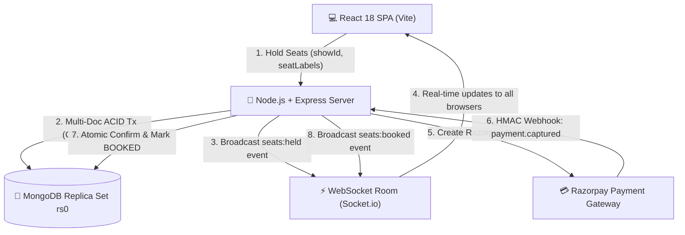
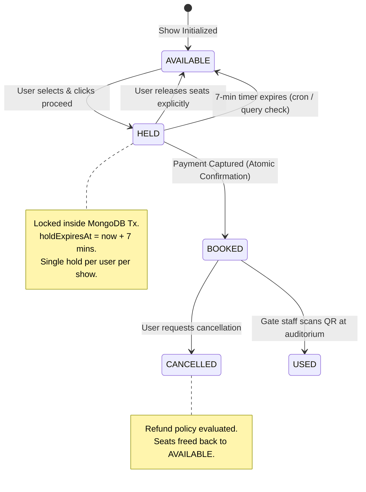

# 🎬 IMovies — Modern Cinema Ticket Booking & Seat Reservation Platform

[](https://nodejs.org/)
[](https://react.dev/)
[](https://vitejs.dev/)
[](https://www.mongodb.com/)
[](https://socket.io/)
[](https://razorpay.com/)
[](#)

> **IMovies** is a full-featured, enterprise-grade movie ticketing and cinema auditorium management system built using the **MERN** stack (MongoDB, Express, React, Node.js). It features an interactive curved seat-map designer, real-time seat lock engine, multi-document ACID transactional booking, Razorpay payment processing, QR-code ticket verification, and an administrative command center.

---

## 📌 Table of Contents
- [1. System Architecture & Diagrams](#-1-system-architecture--diagrams)
- [2. Non-Negotiable Engineering Rules](#-2-non-negotiable-engineering-rules)
- [3. Complete Feature Matrix](#-3-complete-feature-matrix)
- [4. Tech Stack Breakdown](#-4-tech-stack-breakdown)
- [5. Project Directory Structure](#-5-project-directory-structure)
- [6. Installation & Local Setup](#-6-installation--local-setup)
- [7. Environment Variables](#-7-environment-variables)
- [8. Database Seeding & Demo Logins](#-8-database-seeding--demo-logins)
- [9. Running the Application](#-9-running-the-application)
- [10. Complete REST API Reference](#-10-complete-rest-api-reference)
- [11. Testing & Quality Assurance](#-11-testing--quality-assurance)
- [12. Troubleshooting & FAQ](#-12-troubleshooting--faq)

---

## 🏛 1. System Architecture & Diagrams

### High-Level System Workflow


### 7-Minute Seat Hold & Concurrency State Engine


---

## 🛡 2. Non-Negotiable Engineering Rules

1. **Role-Based Access Control (RBAC)**: Exactly two roles exist: `USER` and `ADMIN`. Counter duties (manual verification, ticket scanning, cancellations, refunds) are handled under `ADMIN`.
2. **Zero Client Trust for Money**:
   - Booking requests accept **only** `{ showId, seatLabels[], couponCode? }`.
   - Subtotal, convenience fees, discounts, and total amount are calculated **strictly server-side** using database documents.
   - Client-supplied currency amounts are rejected.
3. **Integer Paise Financial Standard**: All monetary values are stored and calculated in **integer paise** (1 INR = 100 paise). Floating-point math is strictly forbidden.
4. **Seat Concurrency & Hold Safety**:
   - Atomic conditional update inside multi-document transactions:
     ```javascript
     updateMany(
       {
         showId,
         seatLabel: { $in: seatLabels },
         $or: [
           { status: 'AVAILABLE' },
           { status: 'HELD', holdExpiresAt: { $lt: now } }
         ]
       },
       { $set: { status: 'HELD', heldBy: userId, holdExpiresAt } }
     )
     ```
   - If `modifiedCount !== seatLabels.length`, transaction aborts with `409 Conflict`.
   - Centralized `seatAvailability.service.js` acts as the single source of truth across all modules.
5. **Timezone Standard (IST Asia/Kolkata)**:
   - Server runs in UTC; ISO timestamps are persisted in MongoDB.
   - All business logic, show scheduling, cutoff calculations, and user interfaces format dates in Indian Standard Time (`DD MMM YYYY, hh:mm a`) via `utils/ist-date.js`.
6. **Destructive Action Confirmation**: All destructive UI actions (deleting screens, theatres, shows, or releasing holds) require confirmation via a custom `ConfirmDialog` modal (native `window.confirm()` is prohibited).

---

## ✨ 3. Complete Feature Matrix

### 👤 Customer Features
- **Cinematic Homepage**: Dynamic hero banner, filter by City (Mumbai, Bengaluru, Ramgarh, etc.), Now Showing & Upcoming releases.
- **Rich Movie Detail Page**: Official trailers (embedded), duration, certification badges (`U`, `UA`, `A`), genre tags, synopsis, and cast lists.
- **Showtime Selection**: Filter screenings by date (next 7 days), theatre multiplex, audio format (`2D`, `3D`, `IMAX`), and language.
- **Interactive Curved Seat Layout**:
  - Realistic curved theatre layout with Screen indicator.
  - Multi-tier seat categories: **Recliner (VIP)**, **Premium**, and **Regular**.
  - Dynamic price display per category.
  - Visual distinction between available, held, booked, and blocked seats.
- **7-Minute Seat Hold Countdown**: Synchronized timer across browsers with automatic release on expiry.
- **Coupon Discount Engine**: Apply promo codes (e.g., `FLAT100`, `WELCOME50`, `IMOVIES20`) with instant validation and breakdown calculation.
- **Payments & Test Mode Checkout**:
  - Full Razorpay checkout modal integration.
  - Instant One-Click "Test Payment Simulation" for local developer convenience.
- **Printable E-Ticket**:
  - High-res digital ticket with embedded **QR Code**.
  - "Print / Save PDF" option formatted for standard receipt/ticket printers.
- **Booking History & Self-Cancellation**:
  - View upcoming and past booking receipts.
  - Cancel bookings with automated tier-based refund calculations according to cinema policy.
- **User Authentication**:
  - Email & Password with secure JWT tokens.
  - One-click **Demo Login** buttons for instant testing.
  - Profile management & password updates.

### 🛡️ Admin Command Center
- **Executive Dashboard**: Real-time revenue metrics, total bookings, seat occupancy rates, and visual performance charts (Recharts).
- **Movies Catalog Manager**: Add, edit, archive movies with poster URLs, trailer links, runtime, and certificate ratings.
- **Theatres & Multiplexes Management**: Add multiplexes across cities with phone, email, and address info.
- **Auditoriums & Visual Seat Layout Designer**:
  - Custom rows & columns grid designer (up to 20x24).
  - Paint tools: Set individual cells or entire rows as Recliner, Premium, Regular, Aisle Gaps, or Blocked.
  - Automatic seat counter and capacity recalculation.
- **Showtime Scheduler**:
  - Calendar scheduler with automated **Screen Clash Prevention** (includes mandatory 20-minute cleaning & sanitization buffer).
  - Custom category pricing overrides per screening.
- **Live Seat Occupancy Inspector**: View real-time seat occupancy heatmaps for any scheduled screening.
- **Master Bookings & Payments Ledger**: Complete searchable audit trail of all transactions and customer orders.
- **QR Gate Scanner & Ticket Verifier**: Search booking codes (`IMV-...`) or scan QR code to verify tickets and admit patrons (marks status as `USED`).
- **Promotional Coupon Manager**: Create flat or percentage-based coupons with minimum spend requirements and validity dates.
- **User Administration**: View registered users, suspend fraudulent accounts, or promote members to Admin.
- **System Audit Logs**: Immutable trail tracking all mutations (CREATE, UPDATE, DELETE) with before/after snapshots and IP addresses.
- **Reporting & CSV Exports**: One-click streaming CSV exports for Bookings, Revenue, and Occupancy reports.

---

## 🛠 4. Tech Stack Breakdown

### Frontend
- **Framework**: [React 18.3](https://react.dev/) + [Vite 5.4](https://vitejs.dev/)
- **Routing**: [React Router DOM v6](https://reactrouter.com/)
- **UI Framework**: [Bootstrap 5.3](https://getbootstrap.com/) (Custom Dark Glassmorphic Theme)
- **Icons**: [Lucide React](https://lucide.dev/)
- **Visual Charts**: [Recharts](https://recharts.org/)
- **Notifications**: [React Hot Toast](https://react-hot-toast.com/)
- **QR Generation**: [React QR Code](https://github.com/rosskhanas/react-qr-code)
- **Real-Time Client**: [Socket.io Client 4.8](https://socket.io/)

### Backend
- **Runtime**: [Node.js v20 LTS](https://nodejs.org/)
- **Server Framework**: [Express 4](https://expressjs.com/)
- **Database Engine**: [MongoDB 7+](https://www.mongodb.com/) via [Mongoose 8](https://mongoosejs.com/)
- **Multi-Document ACID**: MongoDB Replica Set (`rs0`)
- **Real-Time Engine**: [Socket.io 4.8](https://socket.io/)
- **Security & Middleware**: Helmet, CORS, Express-Rate-Limit, Cookie-Parser, Morgan
- **Validation**: [Zod](https://zod.dev/)
- **Payment Processing**: [Razorpay Node SDK](https://github.com/razorpay/razorpay-node) + HMAC-SHA256 Webhook Verification
- **Background Cron**: [Node-Cron](https://github.com/node-cron/node-cron) for 60-second hold garbage collection

---

## 📂 5. Project Directory Structure

```plaintext
movies-seat-booking/
├── client/                         # Frontend React + Vite Application
│   ├── public/                     # Static assets & favicon
│   ├── src/
│   │   ├── components/             # Reusable UI components
│   │   │   ├── admin/              # AdminSidebar, LayoutBuilder, etc.
│   │   │   ├── movies/             # MovieCard, TrailerModal, etc.
│   │   │   ├── seats/              # SeatMap, SeatCell, SeatLegend
│   │   │   └── ui/                 # Button, Input, Modal, ErrorBoundary, ConfirmDialog
│   │   ├── context/                # AuthContext, CityContext
│   │   ├── hooks/                  # useAuth, useSocket, useCountdown
│   │   ├── lib/                    # api (Axios client), currency formatter
│   │   ├── pages/
│   │   │   ├── admin/              # Dashboard, Movies, Theatres, Screens, Shows, Bookings, etc.
│   │   │   ├── auth/               # LoginPage, RegisterPage, ForgotPasswordPage
│   │   │   ├── public/             # HomePage, MovieDetailPage, SeatSelectionPage
│   │   │   └── user/               # CheckoutPage, TicketPage, MyBookingsPage, ProfilePage
│   │   ├── routes/                 # AppRoutes, ProtectedRoute, AdminRoute
│   │   ├── styles/                 # global.css & theme variables
│   │   ├── App.jsx                 # Top-level application component
│   │   └── main.jsx                # DOM root entrypoint
│   ├── index.html
│   ├── package.json
│   └── vite.config.js
│
├── server/                         # Backend Express + Node.js API
│   ├── scripts/                    # seed.js, e2e-test.js
│   ├── src/
│   │   ├── config/                 # Database connection & env variables
│   │   ├── constants/              # Enums, machine codes, error messages
│   │   ├── controllers/            # admin, user, public, auth controllers
│   │   ├── middleware/             # requireAuth, requireAdmin, errorHandler
│   │   ├── models/                 # User, Movie, Theatre, Screen, Show, ShowSeat, Booking, Payment, AuditLog, Coupon
│   │   ├── routes/                 # admin.routes, user.routes, public.routes, auth.routes
│   │   ├── services/               # seatAvailability, booking, pricing, socket services
│   │   ├── utils/                  # ist-date, auditLogger
│   │   ├── app.js                  # Express application setup
│   │   └── server.js               # HTTP + Socket.io server listener
│   ├── tests/                      # Jest & Supertest suites
│   ├── package.json
│   └── .env.development
│
├── .agents/                        # Repository AI guidelines & rules
├── .gitignore
├── package.json                    # Monorepo root runner
└── README.md                       # Complete documentation (this file)
```

---

## ⚡ 6. Installation & Local Setup

### Step 1: Clone Repository
```bash
git clone https://github.com/shahnawajkhankhan186-ops/imovies-ticket-booking.git
cd imovies-ticket-booking
```

### Step 2: Install All Dependencies
```bash
npm run install:all
```
*(Or install individually: `npm install`, `cd client && npm install`, `cd ../server && npm install`)*

### Step 3: MongoDB Setup with Replica Set (Mandatory)
MongoDB multi-document transactions require a replica set even on a local machine.

- **macOS (Homebrew)**:
  ```bash
  # Check your /opt/homebrew/etc/mongod.conf has:
  # replication:
  #   replSetName: rs0
  brew services restart mongodb-community
  mongosh --eval "rs.initiate()"
  ```
- **Linux (Ubuntu/Debian)**:
  ```bash
  sudo systemctl restart mongod
  mongosh --eval "rs.initiate()"
  ```
- **MongoDB Atlas**:
  Atlas clusters run as replica sets by default. Use your cloud `mongodb+srv://...` URI.

---

## 🔑 7. Environment Variables

### Server Configuration (`server/.env.development`)
```ini
# Server Port & Mode
PORT=5001
NODE_ENV=development

# Database (Must include replicaSet=rs0 or Atlas URI)
MONGODB_URI=mongodb://127.0.0.1:27017/imovies_dev?replicaSet=rs0

# JWT Auth
JWT_SECRET=imovies_dev_jwt_secret_super_secure_key_987654321
JWT_EXPIRES_IN=7d

# Frontend CORS URL
CLIENT_URL=http://localhost:5173

# Razorpay Test Credentials
RAZORPAY_KEY_ID=rzp_test_imovies_dummy_key_id
RAZORPAY_KEY_SECRET=rzp_test_imovies_dummy_secret
RAZORPAY_WEBHOOK_SECRET=rzp_test_imovies_webhook_secret_123

# Business Rules
HOLD_MINUTES=7
CONVENIENCE_FEE_PERCENT=5
MAX_SEATS_PER_BOOKING=8
```

### Client Configuration (`client/.env.development`)
```ini
VITE_API_URL=http://localhost:5001/api
VITE_SOCKET_URL=http://localhost:5001
VITE_RAZORPAY_KEY_ID=rzp_test_imovies_dummy_key_id
```

---

## 🧪 8. Database Seeding & Demo Logins

Populate movies, theatres, screens, seat layouts, upcoming shows for the next 7 days (IST), demo users, and coupons:

```bash
npm run seed
```

### Ready-To-Use Demo Credentials
| Role | Email | Password | Features Accessible |
| :--- | :--- | :--- | :--- |
| **System Administrator** | `admin@imovies.com` | `Admin@123` | Full admin control, screen designer, reports, ticket scanner |
| **User (Demo 1)** | `rahul@example.com` | `User@123` | Browse, hold seats, simulate payment, view QR tickets |
| **User (Demo 2)** | `priya@example.com` | `User@123` | Multi-user seat reservation testing |
| **User (Demo 3)** | `amit@example.com` | `User@123` | Booking cancellation and refunds testing |

> 💡 **Tip**: On the Login screen, click the **"Admin Demo"** or **"User Demo"** quick-fill buttons to sign in without typing!

---

## 🚀 9. Running the Application

### Single Command (Server + Client Concurrently)
```bash
npm run dev
```

The apps will launch at:
- 🌐 **Frontend Client**: [http://localhost:5173](http://localhost:5173)
- ⚙️ **Backend API**: [http://localhost:5001](http://localhost:5001)
- 🩺 **Health Check**: [http://localhost:5001/api/health](http://localhost:5001/api/health)

### Running Separately
```bash
# Terminal 1: Express Server
npm run dev:server

# Terminal 2: Vite Client
npm run dev:client
```

---

## 📡 10. Complete REST API Reference

### 🌐 Public Endpoints (`/api/public/*`)
| Method | Endpoint | Description |
| :--- | :--- | :--- |
| `GET` | `/api/public/movies` | Fetch paginated catalog with status and language filters |
| `GET` | `/api/public/movies/:id` | Fetch movie details, trailer, and user reviews |
| `GET` | `/api/public/movies/:id/shows` | Fetch shows for movie grouped by theatre & date (IST) |
| `GET` | `/api/public/shows/:id/seats` | Real-time seat inventory & screen layout for a show |
| `GET` | `/api/public/cities` | List of distinct active cinema cities |

### 🎟️ User Endpoints (`/api/user/*` — Requires JWT Auth)
| Method | Endpoint | Description |
| :--- | :--- | :--- |
| `POST` | `/api/user/bookings/hold` | Atomically hold seats for 7 minutes & calculate pricing |
| `POST` | `/api/user/bookings/:id/release` | Explicitly release own held seats |
| `POST` | `/api/user/bookings/:id/pay` | Create/resume Razorpay payment order |
| `POST` | `/api/user/bookings/:id/test-pay` | Instant developer test-mode payment confirmation |
| `GET` | `/api/user/bookings` | List authenticated user's bookings with tabs & filters |
| `GET` | `/api/user/bookings/:id` | Single booking receipt & QR data |
| `POST` | `/api/user/bookings/:id/cancel` | Cancel booking with policy-calculated refund |
| `GET` | `/api/user/profile` | View customer profile |
| `PUT` | `/api/user/profile` | Update customer profile info |
| `PUT` | `/api/user/password` | Change password with old password verification |
| `POST` | `/api/user/reviews` | Submit movie rating & review (restricted to attendees) |

### 🛡️ Admin Endpoints (`/api/admin/*` — Requires `ADMIN` Role)
| Method | Endpoint | Description |
| :--- | :--- | :--- |
| `GET` | `/api/admin/dashboard-stats` | Aggregated revenue, ticket counts, and occupancy rates |
| `GET / POST` | `/api/admin/movies` | List and add movies |
| `PUT / DELETE` | `/api/admin/movies/:id` | Update and archive movies |
| `GET / POST` | `/api/admin/theatres` | List and add multiplex theatres |
| `PUT / DELETE` | `/api/admin/theatres/:id` | Update and remove multiplexes |
| `GET / POST` | `/api/admin/screens` | List and create auditorium screens with seat grids |
| `PUT / DELETE` | `/api/admin/screens/:id` | Update screen info and customize visual seat layout |
| `GET / POST` | `/api/admin/shows` | List and schedule shows with clash check buffer |
| `DELETE` | `/api/admin/shows/:id` | Cancel show and initiate automatic patron refunds |
| `GET` | `/api/admin/shows/:id/seats` | Live read-only seat occupancy map for screening |
| `GET` | `/api/admin/bookings` | Master ledger of all bookings across all cinemas |
| `POST` | `/api/admin/bookings/verify` | Gate scanner: Validate QR / code and admit patron (`USED`) |
| `GET` | `/api/admin/payments` | Financial ledger of captured payments |
| `GET` | `/api/admin/refunds` | Financial ledger of processed refunds |
| `GET / PATCH` | `/api/admin/users` | Manage customer accounts & suspend fraudulent users |
| `POST` | `/api/admin/users/create-admin`| Create a new Admin user or promote existing user |
| `GET / POST` | `/api/admin/coupons` | Manage discount coupons |
| `GET` | `/api/admin/reports/:type` | Download itemized CSV reports (`bookings`, `revenue`, `occupancy`) |
| `GET` | `/api/admin/audit-logs` | Immutable audit trail with before/after state snapshots |
| `GET / PUT` | `/api/admin/settings` | Global rules (hold timeout, fee %, cancellation policy) |

### 🔔 Webhooks & System
| Method | Endpoint | Description |
| :--- | :--- | :--- |
| `POST` | `/api/webhooks/razorpay` | HMAC-SHA256 verified raw body payment capture handler |
| `GET` | `/api/health` | System health check (DB replica set status, uptime) |

---

## 🧪 11. Testing & Quality Assurance

### Automated Test Suites
```bash
# Run unit & integration test suites
npm test

# Run 13-step End-to-End lifecycle simulation
npm run test:e2e
```

### Static Analysis & Build Verification
```bash
# Run ESLint across client and server
npm run lint

# Compile production Vite bundle
npm run build
```

---

## ❓ 12. Troubleshooting & FAQ

### Q1: "Transaction numbers are only allowed on a replica set member or mongos"
- **Solution**: MongoDB multi-document transactions require a replica set. Make sure your local MongoDB has `replication.replSetName: rs0` in `mongod.conf` and run `rs.initiate()` in `mongosh`.

### Q2: Black screen when opening screens or layouts?
- **Solution**: All icon imports and layout dimensions are now strictly typed. If encountered, ensure your database has been seeded (`npm run seed`) and refresh the browser. The integrated `ErrorBoundary` will catch any unexpected runtime issues.

### Q3: "Path `pricing.RECLINER` is required" when scheduling a show?
- **Solution**: The screening scheduler expects `RECLINER`, `PREMIUM`, and `REGULAR` pricing tiers. This has been normalized across client and backend controllers to support both `RECLINER` and legacy `VIP` naming seamlessly.

### Q4: Port conflict on 5001 or 5173?
- **Solution**: Check if another process is using the port:
  ```bash
  lsof -i :5001
  lsof -i :5173
  kill -9 <PID>
  ```

---

## 📄 License & Contribution
This codebase is developed and maintained by **Shahnawaj Khan** ([@shahnawajkhankhan186-ops](https://github.com/shahnawajkhankhan186-ops)).

Developed for high-concurrency cinema ticketing and auditorium administration. All rights reserved.
