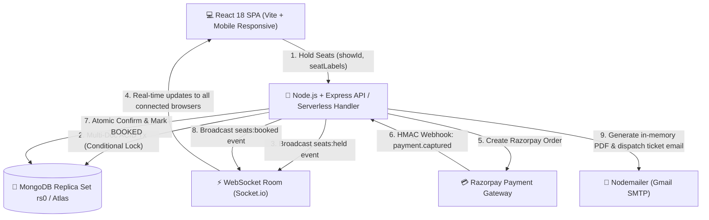
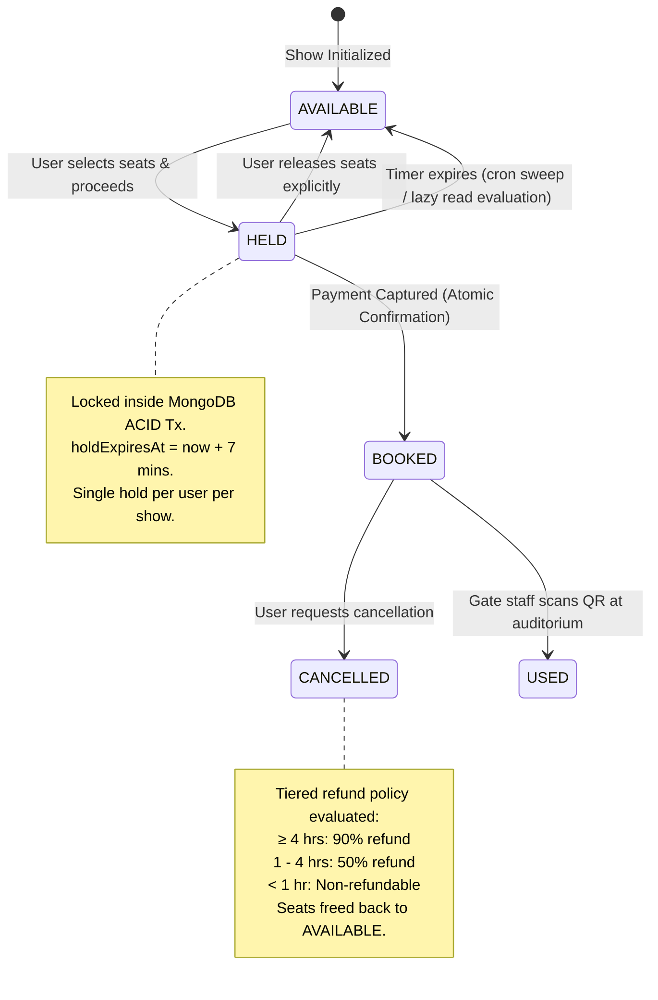

# 🎬 IMovies — Modern Cinema Ticket Booking & Seat Reservation Platform

[](https://nodejs.org/)
[](https://react.dev/)
[](https://vitejs.dev/)
[](https://www.mongodb.com/)
[](https://socket.io/)
[](https://razorpay.com/)
[](https://imovies-ticket-booking-mq7l.vercel.app/)

> **IMovies** is a full-featured, enterprise-grade cinema ticket booking and auditorium management platform built using the **MERN** stack (MongoDB, Express, React, Node.js). It features an interactive curved seat-map designer, real-time seat lock engine, multi-document ACID transactional booking, Razorpay payment processing, dynamic QR-code entry passes, automated in-memory PDF ticket generation with instant email delivery, real Gmail OTP password resets, movie watchlists, fully mobile-responsive UI, and an administrative command center with gate admission scanning and business intelligence reports.

🌐 **Live Production Deployment:** [https://imovies-ticket-booking-mq7l.vercel.app](https://imovies-ticket-booking-mq7l.vercel.app)

---

## 📌 Table of Contents

- [1. System Architecture & Diagrams](#-1-system-architecture--diagrams)
- [2. Non-Negotiable Engineering Hard Rules](#-2-non-negotiable-engineering-hard-rules)
- [3. Complete Feature Matrix](#-3-complete-feature-matrix)
- [4. Tech Stack Breakdown](#-4-tech-stack-breakdown)
- [5. Project Directory Structure](#-5-project-directory-structure)
- [6. Installation & Local Setup](#-6-installation--local-setup)
- [7. Environment Variables Configuration](#-7-environment-variables-configuration)
- [8. Database Seeding & Demo Logins](#-8-database-seeding--demo-logins)
- [9. Running the Application](#-9-running-the-application)
- [10. Complete REST API Reference](#-10-complete-rest-api-reference)
- [11. Email, Real OTP & In-Memory PDF Tickets](#-11-email-real-otp--in-memory-pdf-tickets)
- [12. Serverless & Vercel Deployment Architecture](#-12-serverless--vercel-deployment-architecture)
- [13. Testing & Quality Assurance](#-13-testing--quality-assurance)
- [14. Troubleshooting & FAQ](#-14-troubleshooting--faq)

---

## 🏛 1. System Architecture & Diagrams

### High-Level System Workflow



### Seat Hold & Concurrency State Engine



---

## 🛡 2. Non-Negotiable Engineering Hard Rules

1. **Role-Based Access Control (RBAC)**: Exactly two roles exist: `USER` and `ADMIN`. There is **no STAFF role**. Counter duties (manual verification, ticket scanning, cancellations, refunds) are handled under `ADMIN`.
2. **Zero Client Trust for Money**:
   - Booking requests accept **only** `{ showId, seatLabels[], couponCode? }`.
   - Subtotal, convenience fees, discounts, and total amount are calculated **strictly server-side** using database documents.
   - Client-supplied currency amounts are rejected.
3. **Integer Paise Financial Standard**: All monetary values are stored and calculated in **integer paise** (1 INR = 100 paise). Floating-point math is strictly forbidden.
4. **Seat Concurrency & Hold Safety**:
   - Atomic conditional update inside multi-document transactions:
     ```javascript
     updateMany(
       {
         showId,
         seatLabel: { $in: seatLabels },
         $or: [
           { status: "AVAILABLE" },
           { status: "HELD", holdExpiresAt: { $lt: now } },
         ],
       },
       { $set: { status: "HELD", heldBy: userId, holdExpiresAt } },
     );
     ```
   - If `modifiedCount !== seatLabels.length`, transaction aborts with `409 Conflict`.
   - Centralized `seatAvailability.service.js` acts as the single source of truth across all modules.
5. **Timezone Standard (IST Asia/Kolkata)**:
   - Server runs in UTC; ISO timestamps are persisted in MongoDB.
   - All business logic, show scheduling, cutoff calculations, and user interfaces format dates in Indian Standard Time (`DD MMM YYYY, hh:mm a`) via `utils/ist-date.js`.
6. **Destructive Action Confirmation**: All destructive UI actions (deleting screens, theatres, shows, bookings, or releasing holds) require confirmation via a custom `ConfirmDialog` modal (native `window.confirm()` is prohibited).

---

## ✨ 3. Complete Feature Matrix

### 👤 Customer Features

- **Cinematic Homepage**: Dynamic 5-second auto-cycling hero carousel featuring stacked GPU-accelerated crossfade banner and text glide animations, filter by City (Bhopal, Mumbai, Delhi, Bengaluru, etc.), Now Showing & Upcoming releases.
- **Rich Movie Detail Page**: Official embedded trailers, duration, certification badges (`U`, `UA`, `A`), genre tags, synopsis, cast lists, and user reviews.
- **Watchlist & Favorites System**: Save movies to your personal watchlist with a single heart toggle; manage all saved titles on `/favorites`.
- **Showtime Selection**: Filter screenings by date (next 7 days), theatre multiplex, audio format (`2D`, `3D`, `IMAX`, `4DX`), and language.
- **Interactive Curved Seat Layout**:
  - Realistic curved theatre layout with Screen indicator.
  - Multi-tier seat categories: **Recliner (VIP)**, **Premium**, and **Regular**.
  - Dynamic price display per category.
  - Visual distinction between available, held, booked, and blocked seats.
  - Interactive pan, touch-scroll, and zoom controls with reset.
- **Seat Hold Countdown Timer**: Synchronized 7-minute timer across browsers with automatic release on expiry and explicit release dialog.
- **Coupon Discount Engine**: Apply promo codes (e.g., `FLAT100`, `WELCOME50`, `IMOVIES20`) with instant validation, minimum order requirements, and percentage caps.
- **Payments & Test Mode Checkout**:
  - Full Razorpay checkout modal integration.
  - Instant One-Click "Test Payment Simulation" for developer testing.
- **Printable E-Ticket & Entry Pass**:
  - High-res digital ticket with embedded **QR Code**.
  - Downloadable in-memory **PDF Ticket** generated server-side.
  - Dedicated print stylesheet formatted for standard ticket printers.
- **Instant Email Delivery**: Automated dispatch of official booking confirmation emails with attached PDF ticket pass.
- **Real OTP Password Reset**: Send real 6-digit verification OTPs to user's Gmail inbox with resend cooldown and server-side verification before updating password.
- **Booking History & Self-Cancellation**:
  - View upcoming and past booking receipts.
  - Cancel bookings with automated tier-based refund calculations according to cinema policy.
- **User Authentication**:
  - Email & Password with secure JWT tokens.
  - Google OAuth one-tap authentication.
  - One-click **Demo Login** buttons for instant testing.
  - Profile management & password updates.
- **Fully Mobile Responsive**: All customer pages adapt seamlessly to smartphones, tablets, and ultrawide screens with bottom navigation and drawer support.

### 🛡️ Admin Command Center

- **Executive Dashboard**: Real-time revenue metrics, total bookings, seat occupancy rates, and visual performance charts (Recharts).
- **Movies Catalog Manager**: Add, edit, archive movies with poster URLs, trailer links, runtime, and certificate ratings.
- **Theatres & Multiplexes Management**: Add multiplexes across cities with phone, email, and address info.
- **Auditoriums & Visual Seat Layout Designer**:
  - Custom rows & columns grid designer (up to 20x24).
  - Paint tools: Set individual cells or entire rows as Recliner, Premium, Regular, Aisle Gaps, or Blocked.
  - Automatic seat counter and capacity recalculation.
- **Showtime Scheduler (Enhanced)**:
  - Strict manual scheduling giving administrator 100% control.
  - **Nearest-First Chronological Sorting** (today and upcoming shows first).
  - Comprehensive filters: Search by movie title, filter by multiplex, filter by movie, filter by date (`All`, `Today`, `Tomorrow`, `Upcoming`, `Past`, `Custom Date`), and rows per page selector.
  - Automated screen clash prevention with mandatory 20-minute cleaning buffer.
  - Category pricing overrides per screening.
- **Live Seat Occupancy Inspector**: View real-time seat occupancy heatmaps for any scheduled screening.
- **Master Bookings & Payments Ledger**:
  - Complete searchable audit trail of all transactions and customer orders.
  - **1-Click Booking Record Deletion**: Delete test/unwanted bookings and immediately free all associated seats with `ConfirmDialog` protection.
  - Status filters: `Confirmed`, `Used / Admitted`, `Awaiting Payment`, `Expired`, `Cancelled`.
- **QR Gate Scanner & Ticket Verifier**: Search booking codes (`IMV-...`) or scan QR code to verify tickets and admit patrons (marks status as `USED` and prevents reuse).
- **Reviews & Ratings Moderation**: Inspect all patron reviews and remove inappropriate content.
- **Promotional Coupon Manager**: Create flat or percentage-based coupons with minimum spend requirements and validity dates.
- **User Administration**: View registered users, suspend fraudulent accounts, or promote members to Admin.
- **System Audit Logs**: Immutable trail tracking all mutations (CREATE, UPDATE, DELETE) with before/after snapshots and IP addresses.
- **Reporting & CSV Exports**: One-click streaming CSV exports for Bookings, Revenue, and Occupancy reports.
- **Mobile-Responsive Admin Navigation**: Offcanvas drawer, responsive data tables, touch-optimized dialogs.

---

## 🛠 4. Tech Stack Breakdown

### Frontend

- **Framework**: [React 18.3](https://react.dev/) + [Vite 5.4](https://vitejs.dev/)
- **Routing**: [React Router DOM v6](https://reactrouter.com/)
- **UI Framework**: [Bootstrap 5.3](https://getbootstrap.com/) + Custom Dark Glassmorphic Design System Tokens
- **Icons**: [Lucide React](https://lucide.dev/)
- **Visual Charts**: [Recharts](https://recharts.org/)
- **Notifications**: [React Hot Toast](https://react-hot-toast.com/)
- **QR Generation**: [React QR Code](https://github.com/rosskhanas/react-qr-code)
- **Canvas Rendering**: [HTML2Canvas](https://html2canvas.hertzen.com/)
- **Social Auth**: [@react-oauth/google](https://www.npmjs.com/package/@react-oauth/google)
- **Real-Time Client**: [Socket.io Client 4.8](https://socket.io/)

### Backend

- **Runtime**: [Node.js v20 LTS](https://nodejs.org/)
- **Server Framework**: [Express 4.21](https://expressjs.com/)
- **Serverless Runtime**: Vercel Serverless Functions (`server/api/index.js`)
- **Database Engine**: [MongoDB 7+](https://www.mongodb.com/) via [Mongoose 8.12](https://mongoosejs.com/)
- **Multi-Document ACID**: MongoDB Replica Set (`rs0` or MongoDB Atlas)
- **Real-Time Engine**: [Socket.io 4.8](https://socket.io/)
- **Document Generation**: [PDFKit 0.20](https://pdfkit.org/) for in-memory PDF ticket streaming
- **Email Delivery**: [Nodemailer 10.2](https://nodemailer.com/) (Gmail SMTP integration)
- **Security & Middleware**: Helmet, CORS, Express-Rate-Limit, Cookie-Parser, Morgan, Bcryptjs, JsonWebToken
- **Validation**: [Zod 3.24](https://zod.dev/)
- **Payment Processing**: [Razorpay Node SDK](https://github.com/razorpay/razorpay-node) + HMAC-SHA256 Raw Webhook Verification
- **Hold Garbage Collection**: In-process `node-cron` + lazy on-demand evaluation in serverless environments

---

## 📂 5. Project Directory Structure

```plaintext
movies-seat-booking/
├── client/                         # Frontend React + Vite Application
│   ├── public/                     # Static assets & favicon
│   ├── src/
│   │   ├── components/             # Reusable UI components
│   │   │   ├── admin/              # AdminSidebar, LayoutBuilder, MetricCard
│   │   │   ├── auth/               # GoogleLoginButton
│   │   │   ├── movies/             # MovieCard, ShowTimeChip, TrailerModal
│   │   │   ├── print/              # TicketPrintable (printable receipt view)
│   │   │   ├── seats/              # SeatMap, SeatCell, SeatLegend
│   │   │   └── ui/                 # Button, Input, Modal, ErrorBoundary, ConfirmDialog, etc.
│   │   ├── context/                # AuthContext, CityContext
│   │   ├── hooks/                  # useAuth, useSocket, useCountdown
│   │   ├── lib/                    # api (Axios client), currency, ist-date
│   │   ├── pages/
│   │   │   ├── admin/              # Dashboard, Movies, Theatres, Screens, Shows, Bookings, Reviews, etc.
│   │   │   ├── auth/               # LoginPage, RegisterPage, ForgotPasswordPage (OTP)
│   │   │   ├── public/             # LandingPage, HomePage, MovieDetailPage, SeatSelectionPage
│   │   │   └── user/               # CheckoutPage, TicketPage, MyBookingsPage, ProfilePage, FavoritesPage
│   │   ├── routes/                 # AppRoutes, ProtectedRoute, AdminRoute
│   │   ├── styles/                 # tokens.css & global.css
│   │   ├── App.jsx                 # Top-level application layout
│   │   └── main.jsx                # DOM root entrypoint
│   ├── index.html
│   ├── package.json
│   └── vite.config.js
│
├── server/                         # Backend Express + Node.js API
│   ├── api/                        # Vercel serverless entrypoint (index.js)
│   ├── scripts/                    # seed.js, e2e-test.js
│   ├── src/
│   │   ├── config/                 # db.js, env.js, razorpay.js
│   │   ├── constants/              # enums.js, messages.js
│   │   ├── controllers/            # admin, user, public, auth, webhook controllers
│   │   ├── jobs/                   # expireHolds.js (lazy & cron hold expiration)
│   │   ├── middleware/             # auth, role, validate, rateLimit, errorHandler
│   │   ├── models/                 # User, Movie, Theatre, Screen, Show, ShowSeat, Booking, Payment, AuditLog, Coupon, Review, Favorite, EmailOtp
│   │   ├── routes/                 # admin, user, public, auth, webhook, favorite, health
│   │   ├── services/               # seatAvailability, booking, pricing, refund, report
│   │   ├── sockets/                # seatSocket.js (Socket.io room manager)
│   │   ├── utils/                  # ist-date, pdfTicket, mailer, sms, bookingCode
│   │   ├── app.js                  # Express application setup
│   │   └── server.js               # HTTP + Socket.io server listener
│   ├── tests/                      # Jest integration suites (concurrency, webhooks, pricing)
│   ├── package.json
│   └── .env.development
│
├── .agents/                        # Repository AI guidelines & engineering hard rules
├── .gitignore
├── vercel.json                     # Vercel monorepo deployment config
├── package.json                    # Root workspace runner
└── README.md                       # Comprehensive documentation
```

---

## ⚡ 6. Installation & Local Setup

### Step 1: Clone Repository

```bash
git clone https://github.com/shahnawajkhankhan186-ops/imovies-ticket-booking.git
cd imovies-ticket-booking
```

### Step 2: Install All Dependencies

```bash
npm run install:all
```

_(Or install individually: `npm install`, `cd client && npm install`, `cd ../server && npm install`)_

### Step 3: MongoDB Setup with Replica Set (Mandatory)

MongoDB multi-document transactions require a replica set even on a local machine.

- **macOS (Homebrew)**:
  ```bash
  brew services restart mongodb-community
  mongosh --eval "rs.initiate()"
  ```
- **Linux (Ubuntu/Debian)**:
  ```bash
  sudo systemctl restart mongod
  mongosh --eval "rs.initiate()"
  ```
- **MongoDB Atlas**:
  Atlas clusters run as replica sets by default. Use your cloud `mongodb+srv://...` URI.

---

## 🔑 7. Environment Variables Configuration

### Server Configuration (`server/.env.development` or `server/.env.production`)

```ini
# Server Port & Mode
PORT=5001
NODE_ENV=development

# Database (Must include replicaSet=rs0 or Atlas URI)
MONGODB_URI=mongodb://127.0.0.1:27017/imovies_dev?replicaSet=rs0

# JWT Auth
JWT_SECRET=your_jwt_secret_change_in_production_min_32_chars
JWT_EXPIRES_IN=7d

# Frontend CORS URL
CLIENT_URL=http://localhost:5173

# Razorpay Test Credentials
RAZORPAY_KEY_ID=rzp_test_replace_with_your_key_id
RAZORPAY_KEY_SECRET=rzp_test_replace_with_your_key_secret
RAZORPAY_WEBHOOK_SECRET=rzp_webhook_secret_replace_with_your_webhook_secret

# Google OAuth (Optional - server token verification)
GOOGLE_CLIENT_ID=your_google_client_id_here.apps.googleusercontent.com

# Booking Business Rules
HOLD_MINUTES=7
CONVENIENCE_FEE_PERCENT=5
MAX_SEATS_PER_BOOKING=8

# SMTP Email Configuration (Gmail / Mailgun / AWS SES)
SMTP_HOST=smtp.gmail.com
SMTP_PORT=587
SMTP_SECURE=false
SMTP_USER=your_email@gmail.com
SMTP_PASS=your_gmail_app_password
SMTP_FROM="IMovies Ticketing" <your_email@gmail.com>
```

### Client Configuration (`client/.env.development` or `client/.env.production`)

```ini
VITE_API_URL=http://localhost:5001/api
VITE_SOCKET_URL=http://localhost:5001
VITE_RAZORPAY_KEY_ID=rzp_test_replace_with_your_key_id
VITE_GOOGLE_CLIENT_ID=your_google_client_id_here.apps.googleusercontent.com
```

---

## 🧪 8. Database Seeding & Demo Logins

Populate movies, theatres, screens, visual seat layouts, upcoming shows for the next 7 days (IST), demo users, and coupons:

```bash
npm run seed
```

### Ready-To-Use Demo Credentials

| Role                     | Email               | Password    | Features Accessible                                                                      |
| :----------------------- | :------------------ | :---------- | :--------------------------------------------------------------------------------------- |
| **System Administrator** | `admin@imovies.com` | `Admin@123` | Full admin control, screen layout designer, gate admission scanner, reviews, CSV reports |
| **User (Demo 1)**        | `rahul@example.com` | `User@123`  | Browse, hold seats, simulate payment, view QR & PDF tickets                              |
| **User (Demo 2)**        | `priya@example.com` | `User@123`  | Multi-user seat reservation & concurrency testing                                        |
| **User (Demo 3)**        | `amit@example.com`  | `User@123`  | Booking cancellation and refunds testing                                                 |

> 💡 **Tip**: On the Login screen, click the **"Admin Demo"** or **"User Demo"** quick-fill buttons to sign in without typing!

---

## 🚀 9. Running the Application

### Single Command (Server + Client Concurrently)

```bash
npm run dev
```

The apps will launch at:

- 🌐 **Frontend Client**: [http://localhost:5173](http://localhost:5173)
- ⚙️ **Backend API**: [http://localhost:5001](http://localhost:5001)
- 🩺 **Health Check**: [http://localhost:5001/api/health](http://localhost:5001/api/health)

### Running Separately

```bash
# Terminal 1: Express Server
npm run dev:server

# Terminal 2: Vite Client
npm run dev:client
```

---

## 📡 10. Complete REST API Reference

### 🔐 Authentication (`/api/auth/*`)

| Method | Endpoint                    | Description                                              |
| :----- | :-------------------------- | :------------------------------------------------------- |
| `POST` | `/api/auth/register`        | Register new customer account                            |
| `POST` | `/api/auth/login`           | Email/password login with JWT token issuance             |
| `POST` | `/api/auth/google`          | Google OAuth one-tap token verification & login          |
| `POST` | `/api/auth/forgot-password` | Dispatches real 6-digit verification OTP to user's email |
| `POST` | `/api/auth/verify-otp`      | Validates submitted OTP before allowing password update  |
| `POST` | `/api/auth/reset-password`  | Updates user password with valid OTP verification        |

### 🌐 Public Endpoints (`/api/public/*`)

| Method | Endpoint                       | Description                                                      |
| :----- | :----------------------------- | :--------------------------------------------------------------- |
| `GET`  | `/api/public/movies`           | Fetch paginated catalog with status, genre, and language filters |
| `GET`  | `/api/public/movies/:id`       | Fetch movie details, trailer, and user reviews                   |
| `GET`  | `/api/public/movies/:id/shows` | Fetch shows for movie grouped by theatre & date (IST)            |
| `GET`  | `/api/public/shows/:id/seats`  | Real-time seat inventory & screen layout for a show              |
| `GET`  | `/api/public/cities`           | List of distinct active cinema cities                            |

### 🎟️ User Endpoints (`/api/user/*` — Requires Auth)

| Method | Endpoint                          | Description                                             |
| :----- | :-------------------------------- | :------------------------------------------------------ |
| `POST` | `/api/user/bookings/hold`         | Atomically hold seats for 7 minutes & calculate pricing |
| `POST` | `/api/user/bookings/:id/release`  | Explicitly release own held seats                       |
| `POST` | `/api/user/bookings/:id/pay`      | Create/resume Razorpay payment order                    |
| `POST` | `/api/user/bookings/:id/test-pay` | Instant developer test-mode payment confirmation        |
| `GET`  | `/api/user/bookings`              | List authenticated user's bookings with tabs & filters  |
| `GET`  | `/api/user/bookings/:id`          | Single booking receipt & QR data                        |
| `POST` | `/api/user/bookings/:id/cancel`   | Cancel booking with policy-calculated refund            |
| `GET`  | `/api/user/profile`               | View customer profile                                   |
| `PUT`  | `/api/user/profile`               | Update customer profile info                            |
| `PUT`  | `/api/user/password`              | Change password with old password verification          |
| `POST` | `/api/user/reviews`               | Submit movie rating & review (restricted to attendees)  |

### ❤️ Watchlist & Favorites (`/api/favorite/*` — Requires Auth)

| Method | Endpoint                       | Description                                       |
| :----- | :----------------------------- | :------------------------------------------------ |
| `GET`  | `/api/favorite/my`             | Retrieve all movies in customer's watchlist       |
| `POST` | `/api/favorite/toggle`         | Toggle movie addition / removal from watchlist    |
| `GET`  | `/api/favorite/check/:movieId` | Query whether movie is bookmarked by current user |

### 🛡️ Admin Endpoints (`/api/admin/*` — Requires `ADMIN` Role)

| Method         | Endpoint                     | Description                                                         |
| :------------- | :--------------------------- | :------------------------------------------------------------------ |
| `GET`          | `/api/admin/dashboard-stats` | Aggregated revenue, ticket counts, and occupancy rates              |
| `GET / POST`   | `/api/admin/movies`          | List and add movies                                                 |
| `PUT / DELETE` | `/api/admin/movies/:id`      | Update and archive movies                                           |
| `GET / POST`   | `/api/admin/theatres`        | List and add multiplex theatres                                     |
| `PUT / DELETE` | `/api/admin/theatres/:id`    | Update and remove multiplexes                                       |
| `GET / POST`   | `/api/admin/screens`         | List and create auditorium screens with seat grids                  |
| `PUT / DELETE` | `/api/admin/screens/:id`     | Update screen info and customize visual seat layout                 |
| `GET / POST`   | `/api/admin/shows`           | List and schedule shows (supports filters, search, nearest sorting) |
| `DELETE`       | `/api/admin/shows/:id`       | Cancel show and initiate automatic patron refunds                   |
| `GET`          | `/api/admin/shows/:id/seats` | Live read-only seat occupancy map for screening                     |
| `GET`          | `/api/admin/bookings`        | Master ledger of all bookings across all cinemas                    |
| `DELETE`       | `/api/admin/bookings/:id`    | Delete booking record & immediately release held seats              |
| `POST`         | `/api/admin/bookings/verify` | Gate scanner: Validate QR / code and admit patron (`USED`)          |
| `GET`          | `/api/admin/payments`        | Financial ledger of captured payments                               |
| `GET`          | `/api/admin/refunds`         | Financial ledger of processed refunds                               |
| `GET / PATCH`  | `/api/admin/users`           | Manage customer accounts & suspend fraudulent users                 |
| `POST`         | `/api/admin/users/admin`     | Create a new Admin user or promote existing user                    |
| `GET`          | `/api/admin/reviews`         | Inspect all customer reviews                                        |
| `DELETE`       | `/api/admin/reviews/:id`     | Delete inappropriate review                                         |
| `GET / POST`   | `/api/admin/coupons`         | Manage discount coupons                                             |
| `GET`          | `/api/admin/reports/:type`   | Download itemized CSV reports (`bookings`, `revenue`, `occupancy`)  |
| `GET`          | `/api/admin/audit-logs`      | Immutable audit trail with before/after state snapshots             |
| `GET / PUT`    | `/api/admin/settings`        | Global rules (hold timeout, fee %, cancellation policy)             |

### 🔔 Webhooks & System

| Method | Endpoint                 | Description                                           |
| :----- | :----------------------- | :---------------------------------------------------- |
| `POST` | `/api/webhooks/razorpay` | HMAC-SHA256 verified raw body payment capture handler |
| `GET`  | `/api/health`            | System health check (DB replica set status, uptime)   |

---

## 📧 11. Email, Real OTP & In-Memory PDF Tickets

IMovies incorporates an enterprise-grade communications workflow:

1. **Transactional Ticket Delivery**:
   - On successful payment capture, [pdfTicket.js](server/src/utils/pdfTicket.js) generates a high-definition A5 printable ticket directly into an in-memory `Buffer` via PDFKit without writing temporary files to disk.
   - [mailer.js](server/src/utils/mailer.js) immediately delivers the PDF ticket pass as an attachment to the patron's email address with movie title, showtime (IST), auditorium, seat labels, and booking reference.
2. **Real Gmail OTP Password Reset**:
   - Password resets generate a cryptographic 6-digit OTP stored in MongoDB with a 10-minute TTL ([EmailOtp.js](server/src/models/EmailOtp.js)).
   - Dispatched securely via Gmail SMTP to the user's inbox.
   - Enforces 60-second resend throttling and requires successful OTP validation before passwords can be updated.

---

## ☁️ 12. Serverless & Vercel Deployment Architecture

When deployed on **Vercel** (`serverless` mode):

1. **Database Connection Pooling**: Mongoose reuses cached connections across serverless lambda invocations to avoid exhausting Atlas connection pools.
2. **Lazy Hold Cleanup Engine**: In a serverless environment where background daemons (`node-cron`) do not persist, `cleanupExpiredHolds()` executes lazily and opportunistically on incoming API requests (`server/api/index.js`, `getAdminBookings`, and `getUserBookings`).
3. **Single Monorepo Routing**: `vercel.json` maps `/api/*` to the Node.js serverless function (`server/api/index.js`) and routes all other paths to the static Vite frontend (`client/dist`).

---

## 🧪 13. Testing & Quality Assurance

### Automated Test Suites

```bash
# Run unit & integration test suites
npm test

# Run 13-step End-to-End lifecycle simulation
npm run test:e2e
```

### Static Analysis & Build Verification

```bash
# Run ESLint across client and server
npm run lint

# Compile production Vite bundle
npm run build
```

---

## ❓ 14. Troubleshooting & FAQ

### Q1: "Transaction numbers are only allowed on a replica set member or mongos"

- **Solution**: MongoDB multi-document transactions require a replica set. Make sure your local MongoDB has `replication.replSetName: rs0` in `mongod.conf` and run `rs.initiate()` in `mongosh`.

### Q2: Shows section is not displaying all shows?

- **Solution**: Use the pagination controls (Prev/Next) and filter bar. By default, shows are sorted chronologically with **Nearest Showtime First** (`asc`), prioritizing today's and upcoming shows. You can switch to **Furthest First** or adjust the rows per page (25, 50, 100, All).

### Q3: Abandoned checkout shows "Awaiting Payment" in admin ledger?

- **Solution**: Any unpaid seat hold expires automatically after 7 minutes. The serverless cleanup engine transitions expired holds to `EXPIRED` and frees seats upon any ledger query or API request. Administrators can also delete records directly with the Trash button.

### Q4: Port conflict on 5001 or 5173?

- **Solution**:
  ```bash
  lsof -i :5001
  lsof -i :5173
  kill -9 <PID>
  ```

---

## 📄 License & Maintainer

This project is engineered and maintained by **Shahnawaj Khan** ([@shahnawajkhankhan186-ops](https://github.com/shahnawajkhankhan186-ops)).

Developed for high-concurrency cinema ticketing and auditorium administration. All rights reserved.
